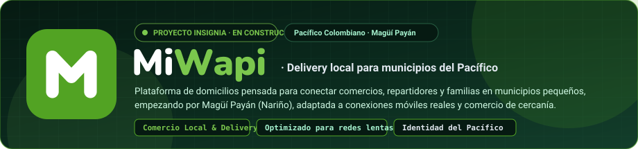
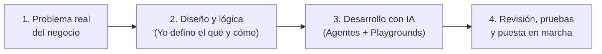
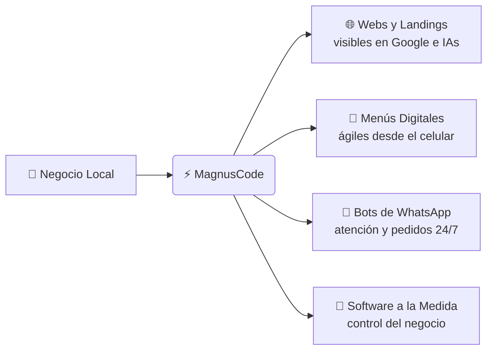

  

   
   

  <!-- Botones de contacto directo -->
  
  
  
  

 

Construyo **webs, menús digitales, bots de WhatsApp y software a la medida** para que negocios locales vendan más y automaticen su operación. Estudio **Ingeniería de Sistemas en la Universidad Icesi** (becado al 100%) en Cali, tengo mis raíces en **Magüí Payán (Nariño)** y me muevo a diario con **Linux, Termux y prácticas de ciberseguridad**.

> **🎯 Caso real — [Voltag Gym](https://voltag-landing.vercel.app):** desarrollé su landing page optimizada para que tanto buscadores como motores de IA la encuentren y la recomienden. **Pasó de ser un gimnasio escondido a recibir gente nueva.**

---

## 🌿 Proyecto Insignia: Mi Wapi *(En construcción)*

  

 

**Mi Wapi** es la plataforma de domicilios que estoy construyendo hoy para municipios pequeños del Pacífico colombiano, empezando por mi tierra, **Magüí Payán (Nariño)**:

- **Pensada para el contexto real de la región:** interfaz rápida, ligera y diseñada para funcionar bien incluso con conexiones móviles lentas.
- **Ecosistema local completo:** conecta a los negocios del municipio, a los domiciliarios y a las familias desde cualquier celular.
- **Identidad propia del Pacífico:** sistema visual, colores y experiencia inspirados en el territorio nariñense.

---

## 🎓 Formación y Base Técnica

| Área | Detalle |
| :--- | :--- |
| **🏛️ Ingeniería de Sistemas** | **Universidad Icesi** (Cali, Colombia) — Primer año · **Beca del 100%**. Bases de algoritmos, estructuras de datos, **Python** y **Java**. |
| **🐧 Linux, Termux & Ciberseguridad** | Trabajo sobre servidores remotos **Debian (`code-server`)**, uso **Termux** para programar y administrar desde la terminal móvil e incursiono en **ciberseguridad**. |
| **🕊️ Formación complementaria** | Curso **Programadores para la Paz** ([ver repositorio de actividades](https://github.com/juanpps/programadores-para-la-paz)). |

---

## 🧠 Cómo trabajo: Dirección Técnica + IA

Integro **agentes de IA y Playgrounds** en mi flujo de desarrollo para construir más rápido sin perder el control del código:

- **Yo tomo las decisiones:** defino la arquitectura, la base de datos y cómo debe funcionar el producto para el usuario final.
- **La IA acelera la ejecución:** me apoyo en modelos y playgrounds para iterar código a alta velocidad, dedicando mi tiempo a revisar la lógica, pulir detalles y entregar software que funcione en el mundo real.

---

## 🛠️ Qué hago en MagnusCode

- **Sitios web y landings** rápidos, claros y listos para aparecer cuando alguien busca en Google o pregunta a una IA.
- **Menús digitales** cómodos de abrir y pedir desde cualquier celular.
- **Bots de WhatsApp** que responden dudas y toman pedidos automáticamente.
- **Herramientas a la medida** para resolver tareas del día a día de cada negocio.

---

## 🚀 Proyectos y Clientes

| Proyecto | Estado | Qué es y qué resuelve | Enlaces |
| :--- | :---: | :--- | :---: |
| **Mi Wapi** *(Miwapi)* |  | App de domicilios propia para municipios pequeños del Pacífico colombiano, empezando por **Magüí Payán**. | `Repo Privado` |
| **Casa Lamad** |  | Menú digital interactivo en tiempo real e integración con bot de WhatsApp para atención y pedidos. |    |
| **Voltag Gym** |  | Landing page optimizada para buscadores y asistentes de IA que ayudó a atraer nuevos clientes al gimnasio. |   |
| **Método Raptor** |  | Plataforma pre-ICFES donde soy el programador del **sistema de calificación** y del **campus virtual**. |  |

<b>📂 Ver más proyectos y herramientas que he construido (clic para desplegar)</b>

 

- **TeBoto** y **StudyClip AI** — Proyectos propios en desarrollo.
- **MagnusCRM** y **[Sistema SaaS de Inventario](https://github.com/juanpps/inventario-saas)** ([ver demo](https://inventario-saas-ten.vercel.app)) — Herramientas de gestión comercial.
- **Gestor de malla curricular de Icesi**, **Calculadora de puntaje ICFES para Univalle**, **[ICFES-SRS (InglesCards)](https://github.com/juanpps/inglescards)** ([ver demo](https://inglescards.vercel.app)) y **[LaBiblio](https://github.com/juanpps/labiblio)** ([ver demo](https://labiblio.vercel.app)).
- **Impresión térmica ESC/POS** — Módulo para imprimir recibos en puntos de venta.
- **Dashboard financiero de paintball con visualizador 3D**, **Gesture Particle Canvas** (control con gestos de mano por cámara), **Open Sports Tournament Tracker** (torneos con JSON abiertos), **Amigurumi Studio** y **COPy**.
- **Idea a futuro — MaguiAprende:** proyecto en etapa de idea para crear una plataforma educativa pensada para jóvenes del Pacífico.

---

## 💻 Stack y Herramientas

  

 

  
  
  
  

- **Lenguajes y Frontend:** TypeScript · Python · Java · Next.js 14 · Astro · Tailwind CSS
- **Backend y Despliegue:** Supabase · Firebase · Appwrite · GitHub Actions · Vercel · Netlify
- **Entorno diario:** Linux (Debian con `code-server`) · Termux · Prácticas de Ciberseguridad · Playgrounds y agentes de IA

---

## 📊 Actividad en GitHub

<!-- NOTA: Si alguna tarjeta pública de Vercel falla por rate-limit, conviene autohospedarla en tu cuenta de Vercel. -->

  
  

  

---

**Fuera del código:** calistenia, Ultimate Frisbee con el equipo de la U, rodar en moto por Cali, salsa de Rubén Blades y Willie Colón, Alcolirykoz, buen café mientras programo, lecturas de Marco Aurelio o Camus, *Shingeki no Kyojin*, *BoJack Horseman*, Minecraft survival y flashear ROMs.

   
  <b>¿Tienes un negocio y quieres digitalizarlo, o buscas construir un producto?</b>
   
  <a href="https://wa.me/573241241417">Escríbeme directo por WhatsApp</a> · <a href="mailto:migueljuanguerrerot@gmail.com">migueljuanguerrerot@gmail.com</a>

