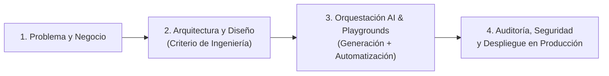
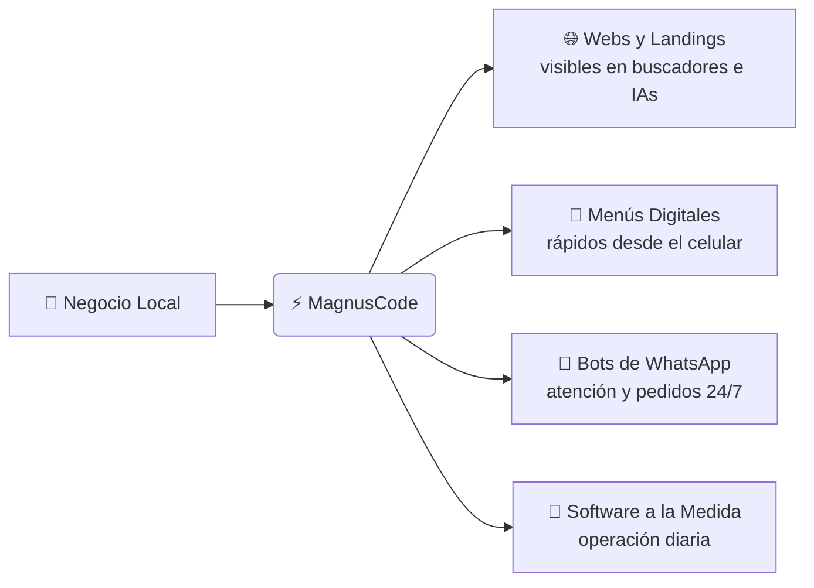

  

   
   

  <!-- Botones de contacto directo -->
  
  
  
  

 

Diseño y despliego **webs, menús digitales, bots de WhatsApp y software a la medida** para que negocios locales vendan y operen mejor. Estudiante becado de **Ingeniería de Sistemas en la Universidad Icesi** (Cali), con raíces en **Magüí Payán (Nariño)** e incursionando en **ciberseguridad y entornos Linux**.

> **🎯 Caso real — Voltag Gym:** diseñé su landing page optimizada para que los motores de IA la encuentren y la recomienden. **Pasó de ser un gimnasio escondido a recibir gente nueva.**

---

## 🎓 Formación y Enfoque Técnico

| Área | Detalle |
| :--- | :--- |
| **🏛️ Ingeniería de Sistemas** | **Universidad Icesi** (Cali, Colombia) — Primer año · **Becado al 100%**. Fundamentos algorítmicos, programación en **Python** y **Java**, y arquitectura de sistemas. |
| **🛡️ Ciberseguridad & Linux** | Incursionando en seguridad informática, administración de servidores remotos **Debian (`code-server`)**, entornos móviles de desarrollo y consola con **Termux**, y experimentación a bajo nivel. |
| **🕊️ Formación complementaria** | Graduado del programa **Programadores para la Paz**. |

---

## 🧠 Metodología: Ingeniería Orquestada con IA (*AI-First*)

No uso la IA para copiar y pegar a ciegas; **trabajo como arquitecto y director técnico apalancado en agentes de IA y playgrounds**:

- **Arquitectura y criterio propio:** defino el modelo de datos, la lógica de negocio, las integraciones y la experiencia de usuario antes de generar una sola línea.
- **Velocidad de entrega 10x:** utilizo agentes de IA y **Playgrounds** como multiplicadores de fuerza para prototipar, iterar y automatizar código repetitivo, concentrándome en la revisión técnica, la seguridad y el impacto real en el cliente.

---

## 🛠️ Qué construyo en MagnusCode

- **Sitios web y landings** pensados para convertir visitas y aparecer cuando alguien pregunta en buscadores o asistentes de IA.
- **Menús digitales** rápidos, claros y cómodos de pedir desde cualquier celular.
- **Bots de WhatsApp** para automatizar atención al cliente y toma de pedidos.
- **Herramientas a la medida** para resolver operaciones puntuales de cada negocio.

---

## 🚀 Proyectos destacados

| Proyecto | Estado | Qué es y qué problema resuelve |
| :--- | :---: | :--- |
| **Mi Wapi** *(Miwapi)* |  | App de delivery propia pensada para municipios pequeños del Pacífico colombiano, empezando por **Magüí Payán**. <!-- PENDIENTE: enlace a Mi Wapi --> |
| **Casa Lamad** |  | Menú digital interactivo e integración con bot de WhatsApp para atención y pedidos. <!-- PENDIENTE: enlace a Casa Lamad --> |
| **Voltag Gym** |  | Landing page optimizada para descubrimiento en buscadores e IAs; llevó flujo de clientes nuevos al gimnasio. <!-- PENDIENTE: enlace a Voltag Gym --> |
| **Método Raptor** |  | Plataforma de preparación pre-ICFES donde soy el programador del **sistema de calificación** y del **campus virtual**. <!-- PENDIENTE: enlace si aplica --> |

<b>📂 Ver más proyectos, laboratorios y herramientas que he construido (clic para desplegar)</b>

 

- **TeBoto** y **StudyClip AI** — Proyectos propios en desarrollo. <!-- PENDIENTE: detalle de una línea confirmado por Juan -->
- **MagnusCRM** — Sistema propio de gestión de clientes. <!-- PENDIENTE: detalle corto -->
- **Gestor de malla curricular de Icesi** y **Calculadora de puntaje ICFES para Univalle**.
- **Impresión térmica ESC/POS** — Módulo para impresión de recibos en punto de venta.
- **Dashboard financiero de paintball con visualizador 3D**, **Gesture Particle Canvas** (control por gestos de mano en cámara), **Open Sports Tournament Tracker** (repos JSON abiertos), **Amigurumi Studio** y **COPy**.
- **Visión a futuro — MaguiAprende:** idea en diseño para llevar una plataforma educativa digital a jóvenes del Pacífico.

---

## 💻 Stack Tecnológico y Entornos

  

 

  
  
  
  

- **Lenguajes y Web:** TypeScript · Python · Java · Next.js 14 · Astro · Tailwind CSS
- **Backend, Cloud y CI/CD:** Supabase · Firebase · Appwrite · GitHub Actions · Vercel · Netlify
- **Sistemas, Seguridad e IA:** Linux (Debian / `code-server`) · Termux · Laboratorios de Ciberseguridad · AI Playgrounds & Agentes

---

## 📊 Actividad en GitHub

<!-- NOTA: Si alguna tarjeta pública de Vercel falla por rate-limit, conviene autohospedarla en tu cuenta de Vercel. -->

  
  

  

---

**Fuera del código:** calistenia, Ultimate Frisbee con el equipo de la universidad, rodar en moto por Cali, salsa de Rubén Blades y Willie Colón, Alcolirykoz, buen café mientras programo, lecturas de Marco Aurelio o Camus, *Shingeki no Kyojin*, *BoJack Horseman*, Minecraft survival y flasheo de ROMs.
