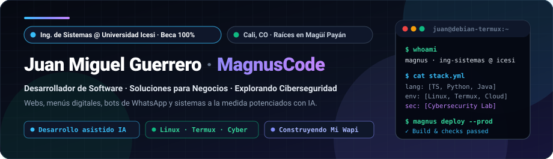
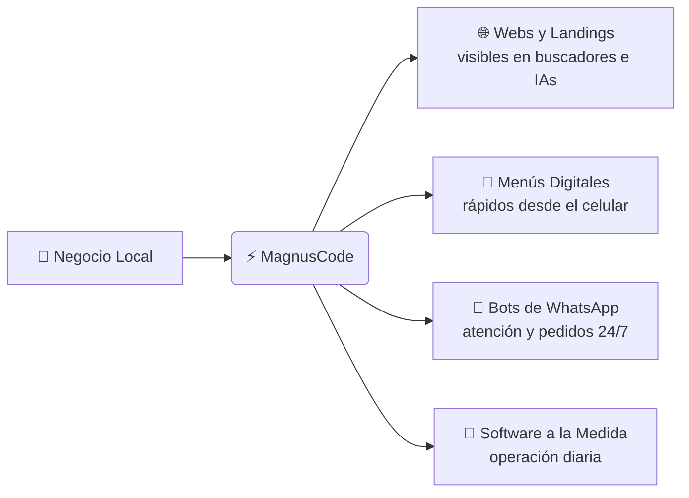
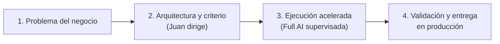

  

   
   

  <!-- Botones de contacto directo -->
  
  
  
  

 

Construyo **webs, menús digitales, bots de WhatsApp y software a la medida** para que negocios locales vendan y operen mejor. Basado en **Cali**, con raíces en **Magüí Payán (Nariño)**.

> **🎯 Caso real — Voltag Gym:** diseñé su landing page optimizada para que los motores de IA la encuentren y la recomienden. **Pasó de ser un gimnasio escondido a recibir gente nueva.**

---

## 🛠️ Qué hago en MagnusCode

- **Sitios web y landings** pensados para convertir visitas y aparecer cuando alguien pregunta en buscadores o asistentes de IA.
- **Menús digitales** rápidos, claros y cómodos de pedir desde cualquier celular.
- **Bots de WhatsApp** para automatizar atención al cliente y toma de pedidos sin perder el toque humano.
- **Herramientas a la medida** para resolver operaciones puntuales de cada negocio.

---

## 🚀 Proyectos destacados

| Proyecto | Estado | Qué es y qué problema resuelve |
| :--- | :---: | :--- |
| **Mi Wapi** *(Miwapi)* |  | App de delivery propia pensada para municipios pequeños del Pacífico colombiano, empezando por **Magüí Payán**. <!-- PENDIENTE: enlace a Mi Wapi --> |
| **Casa Lamad** |  | Menú digital interactivo e integración con bot de WhatsApp para atención y pedidos. <!-- PENDIENTE: enlace a Casa Lamad --> |
| **Voltag Gym** |  | Landing page optimizada para descubrimiento en buscadores e IAs; llevó flujo de clientes nuevos al gimnasio. <!-- PENDIENTE: enlace a Voltag Gym --> |
| **Método Raptor** |  | Plataforma de preparación pre-ICFES donde soy el programador del **sistema de calificación** y del **campus virtual**. <!-- PENDIENTE: enlace si aplica --> |

<b>📂 Ver más proyectos y herramientas que he construido (clic para desplegar)</b>

 

- **TeBoto** y **StudyClip AI** — Proyectos propios en desarrollo. <!-- PENDIENTE: detalle de una línea confirmado por Juan -->
- **MagnusCRM** — Gestión de clientes propia. <!-- PENDIENTE: detalle corto -->
- **Gestor de malla curricular de Icesi** y **Calculadora de puntaje ICFES para Univalle**.
- **Impresión térmica ESC/POS** — Módulo para recibos de punto de venta.
- **Dashboard financiero de paintball con visualizador 3D**, **Gesture Particle Canvas** (control por gestos de mano en cámara), **Open Sports Tournament Tracker** (repos JSON abiertos), **Amigurumi Studio** y **COPy**.

---

## 📍 En qué estoy ahora

- 🚧 **Construyendo Mi Wapi:** creando tecnología pensada para la realidad de los municipios del Pacífico.
- 🎓 **Ingeniería de Sistemas en la Universidad Icesi:** cursando primer año (becado al 100%). Formación complementaria en *Programadores para la Paz*.
- 💡 **Visión a futuro — MaguiAprende:** una idea (aún por ejecutar) para crear una plataforma educativa dirigida a jóvenes del Pacífico.

---

## ⚡ Cómo trabajo y Stack

Trabajo con un enfoque *AI-first*: **"full AI, yo me encargo de dirigir"**. Defino qué se construye, dirijo y superviso a los modelos con criterio técnico y valido cada entrega.

  
   
  <b>Next.js 14 · TypeScript · Supabase · Firebase · Vercel · Netlify · Astro · Appwrite · GitHub Actions · Tailwind CSS</b>

---

## 📊 Actividad en GitHub

<!-- NOTA: Si alguna tarjeta pública de Vercel falla por rate-limit, conviene autohospedarla en tu cuenta de Vercel. -->

  
  

  

---

**Fuera del código:** calistenia, Ultimate Frisbee con el equipo de la universidad, rodar en moto por Cali, salsa de Rubén Blades y Willie Colón, Alcolirykoz, buen café mientras programo, lecturas de Marco Aurelio o Camus, *Shingeki no Kyojin*, *BoJack Horseman*, Minecraft survival y cacharrear servidores Debian con `code-server` o flasheo de ROMs.
